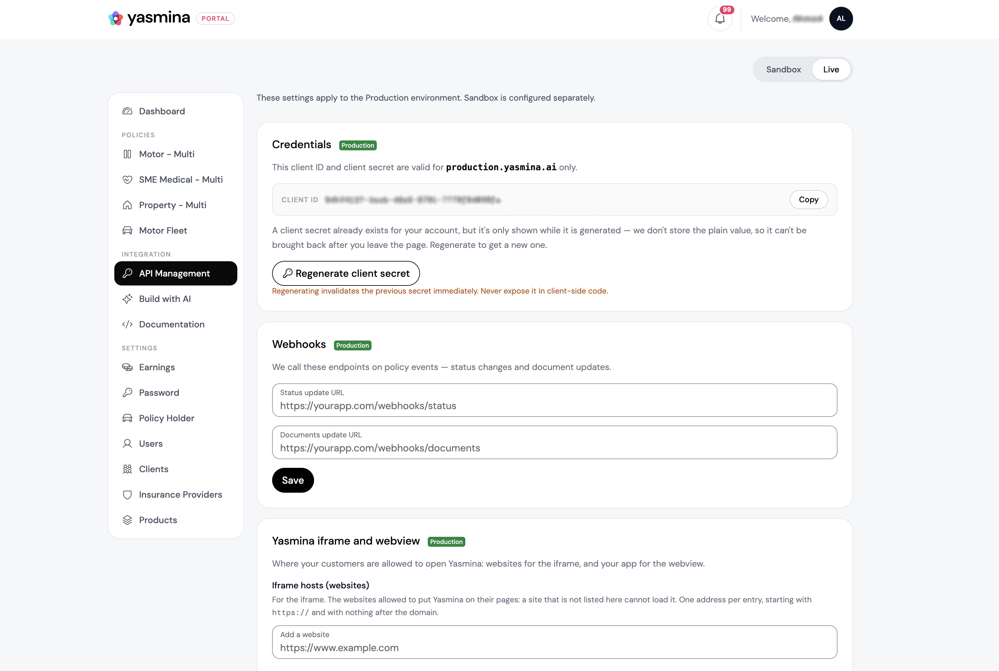

To access any of our APIs, you need to authorize yourself using the <a href="/auth-api-reference/oauth-20/generate-token" target="_blank">Generate Token API</a>. We are using the standard <a href="https://oauth.net/2/grant-types/client-credentials" target="_blank">OAuth 2.0 client credentials</a>.

The Generate Token API requires a Client ID and Client Secret. You can head over to <a href="https://portal.yasmina.ai/api-management" target="_blank">API Management</a> to retrieve them.
	
In this page you can Generate a new client secret. Copy both the Client ID and Client Secret.

Sandbox and Live each have their own client secret. Switch to the environment you will call at the top of API Management and generate the secret there: a Live secret works only on `production.yasmina.ai`, and a Sandbox secret only on `sandbox.yasmina.ai`.

<Note>The client secret is shown only once, when it is generated. Copy it straight away: it can't be shown again after you leave the page.</Note>

Now you can get a secure JWT token from the <a href="/auth-api-reference/oauth-20/generate-token" target="_blank">
Generate Token API</a>

<Warning>When you generate a new client secret the previous one will be invalid, so use the **Regenerate client secret** button with care.</Warning>