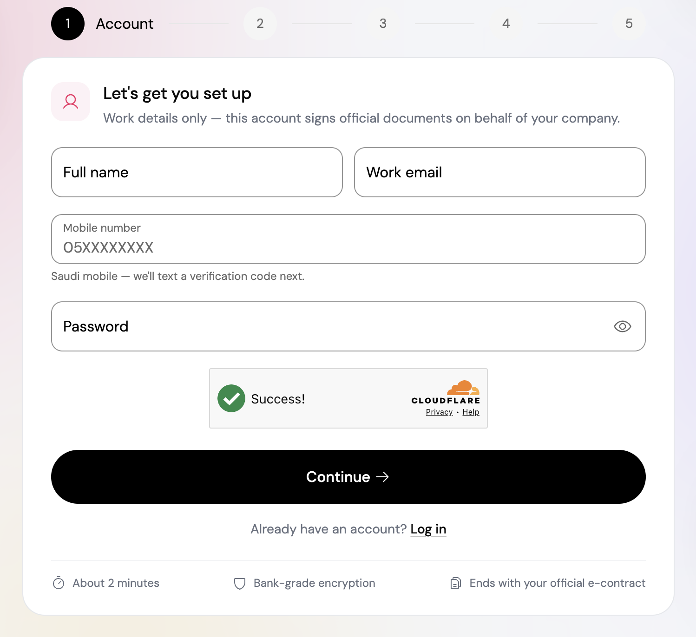
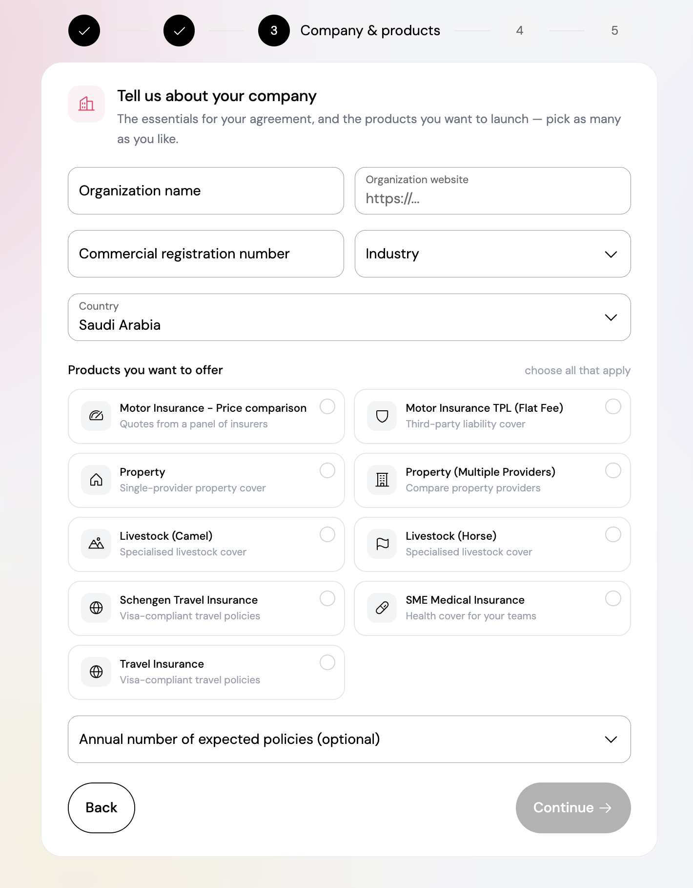
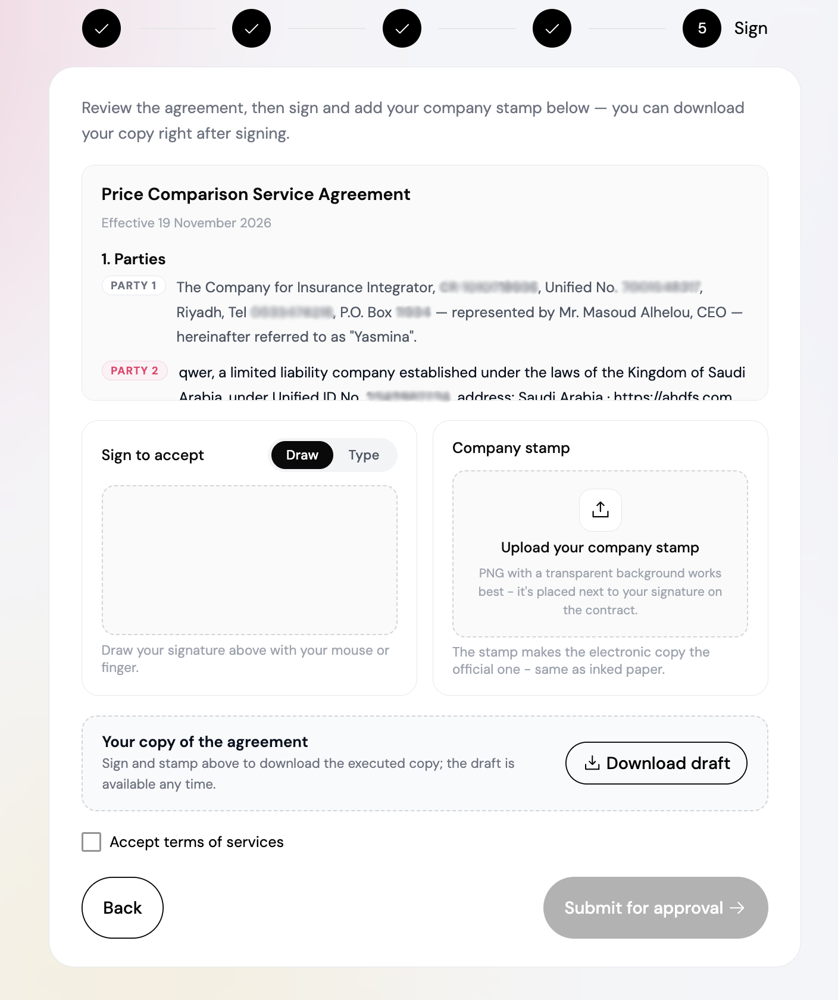

### About Yasmina

Yasmina makes it easy for online businesses to offer different insurance products to their customers through a fully integrated,
API-first solution. Whether you're a tech platform, e-commerce store, or HR system, Yasmina gives you the tools to generate insurance quotes, issue policies, and manage claims — all through a simple, standard RESTful APIs.

Our platform sits in the middle of Insurance Providers and Businesses.

💡 Sign up yourself, with no sales call needed. Our team reviews every application, usually within 24 hours.

### Onboarding

<Steps>
  <Step icon="user-plus" title="Create your account">
	Head over to https://portal.yasmina.ai/signup and fill in your full name, work email, Saudi mobile number and a password.
	
  </Step>
  <Step icon="shield-check" title="Verify your identity">
	Confirm your email and mobile number with the codes we send you, and enter the National ID or Iqama number of the authorized signatory: you sign the agreement on behalf of your company.
  </Step>
  <Step icon="building" title="Tell us about your company and products">
	Enter your company's details and pick the products you want to offer. You can choose as many as you like.
	
  </Step>
  <Step icon="building-columns" title="Add your payout details">
	Add the IBAN where your revenue share is paid, and your Zakat number if you have one. This step is optional: you can skip it and add your IBAN later under **Earnings**.
  </Step>
  <Step icon="file-signature" title="Sign the agreement">
	Review the service agreement, sign it, upload your company stamp and accept the terms of service, then click **Submit for approval**. You can download your copy of the signed agreement.
	
	<Tip>Made a mistake or missed something after submission? You can reset your submission and update the details anytime.</Tip>
  </Step>
  <Step icon="clock" title="Wait for approval">
	Our team reviews every application, usually within 24 hours, and emails you once you're approved. Access to each environment, Sandbox and Live, is enabled by your account manager.
  </Step>
  <Step icon="plug" title="Start developing the integration">
	Get your Client ID and Client Secret from API Management, as described in [Authentication](/authentication), then follow the guide for your product below.
  </Step>
</Steps>

### Insurance Integrations Guides

- **Single Insurance Provider**
  - [SME Medical Insurance](/single-provider-integrations/sme-medical-insurance)
  - [Motor Insurance](/single-provider-integrations/motor-insurance)
  - [Property Insurance](/single-provider-integrations/property)
  - [Travel Insurance](/single-provider-integrations/travel)
  - [Life Insurance (S&P)](/single-provider-integrations/life)
  - [Horse Insurance](/single-provider-integrations/horse)
- **Price Comparison**
  - [SME Medical Insurance](/price-comparison/sme-medical-insurance)
  - [Motor Insurance](/price-comparison/motor-insurance)
  - [Property Insurance](/price-comparison/property)
